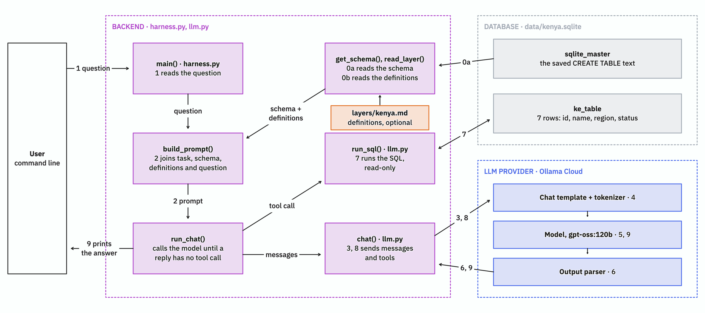

# Inside an LLM-Based Data Agent

A small data agent that answers one question about a SQLite database. A language model writes the SQL, and ordinary Python code does everything else: it reads the schema, builds the prompt, runs the query and decides when to stop.

This is the code behind the post [Inside an LLM-Based Data Agent: From a Question, to a Tool Call, to an Answer](https://mblessed.space/blog/inside-an-llm-based-data-agent). Every prompt, request and reply in the post comes from the traces in `traces/`.

## How It Works



The numbers match the diagram:

1. 0a and 0b, at start-up: `get_schema()` reads the `CREATE TABLE` text from SQLite. If you pass `--layer`, `read_layer()` reads the definitions file.
2. 1: `main()` reads the question from the command line.
3. 2: `build_prompt()` joins the task, the schema, the definitions and the question into one user message.
4. 3: `chat()` sends the messages and the tool description to Ollama.
5. 4 to 6: the provider applies the chat template, runs the model and turns its output back into JSON with a tool call.
6. 7: `run_sql()` runs the query on a read-only connection.
7. 8: `run_chat()` adds the rows as a `tool` message and calls the model again.
8. 9: the model writes the answer, and `main()` prints it.

The model never connects to the database. Only the backend does.

## The Example

The database is one table, `ke_table`, with seven made-up people:

| id | name | region | status |
|---|---|---|---|
| 1 | Amina | Nairobi | R |
| 2 | Brian | Nairobi | R |
| 3 | Chege | Nairobi | V |
| 4 | Daudi | Coast | R |
| 5 | Esther | Coast | R |
| 6 | Faith | Coast | R |
| 7 | Grace | Nairobi | V |

In `status`, R means resident and V means visitor. The database does not store that meaning. The file `layers/kenya.md` writes it down, so that the agent can add it to the prompt.

## Files

| File | What it does |
|---|---|
| `harness.py` | Reads the schema, builds the prompt and runs the agent loop. |
| `llm.py` | Holds the model settings, the `run_sql` tool and the client that calls the model. |
| `make_db.py` | Creates `data/kenya.sqlite`. `harness.py` runs it when the file does not exist. |
| `layers/kenya.md` | The semantic layer: one line that says what R and V mean. |
| `render_template.py` | Rebuilds the text that the model reads for the first request, with OpenAI's harmony library. |
| `traces/` | The saved runs that the post uses. |

## Set Up

You need Python 3.12, [uv](https://docs.astral.sh/uv/) and an [Ollama](https://ollama.com) API key. The model, `gpt-oss:120b`, runs on Ollama's servers.

1. Clone the repository and go into it.
2. Copy `.env.example` to `.env`.
3. In `.env`, set `OLLAMA_API_KEY` to your key.
4. Install the dependencies:

```bash
uv sync
```

## Run

Ask the question without the semantic layer:

```bash
uv run python harness.py --seed 2 "Find the region with the most people in Kenya."
```

Ask the question that needs the `status` column, with the semantic layer:

```bash
uv run python harness.py --seed 2 --layer layers/kenya.md "Find the region with the most residents in Kenya."
```

To save the prompt and every request and response, add `--trace traces/<name>.json`.

To rebuild the text that the model reads for the first request of a trace:

```bash
uv run --group template python render_template.py traces/people_seed2.json
```

## What to Expect

The model samples its output, so your run can differ from the traces, even with the same seed. The post uses seed 2. With seeds 1 to 5, the model answered the first question with one query in four runs. With seed 1, it first checked which values `status` holds, so it made three queries and four model calls.

The agent loop stops after 15 tool calls. This limit is a setting in `harness.py` (`MAX_TOOL_CALLS`), not a rule of the API.

## Checks

CI runs the [comment-ratchet](https://github.com/blessedmadukoma/comment-ratchet) pre-commit hook on every push and pull request. The hook fails when a file has more code comments than `.comment-ratchet.json` allows. To run it on your machine:

```bash
uvx pre-commit run comment-ratchet --all-files
```

## License

MIT. See `LICENSE`.
